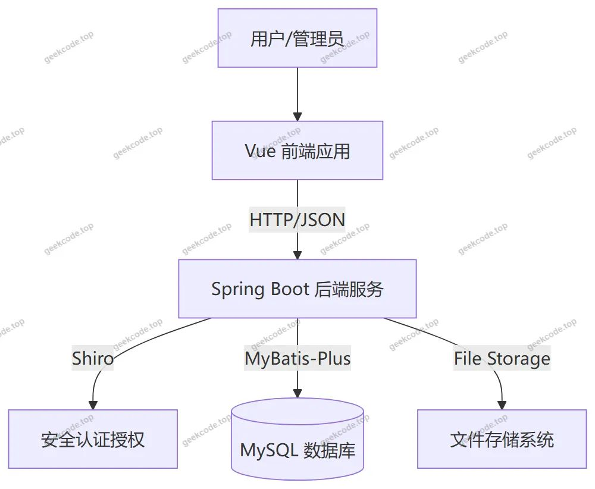
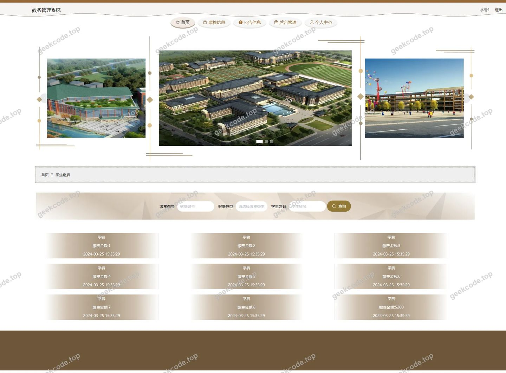
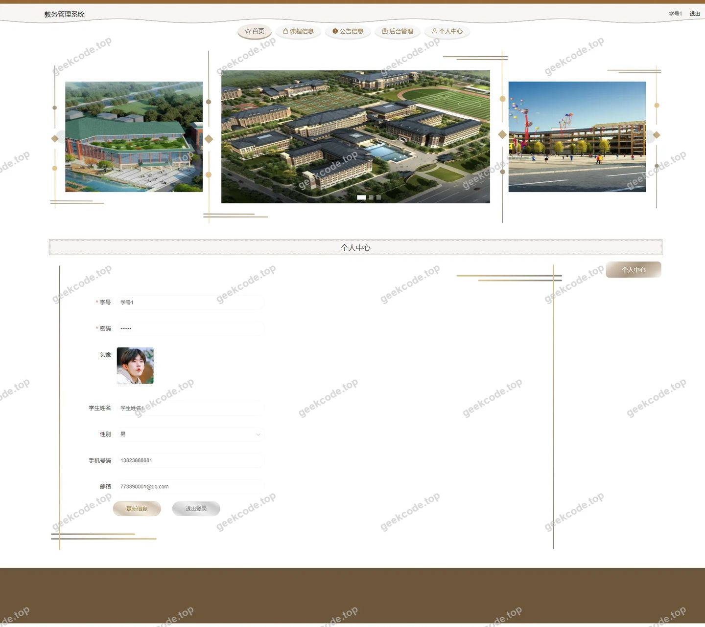
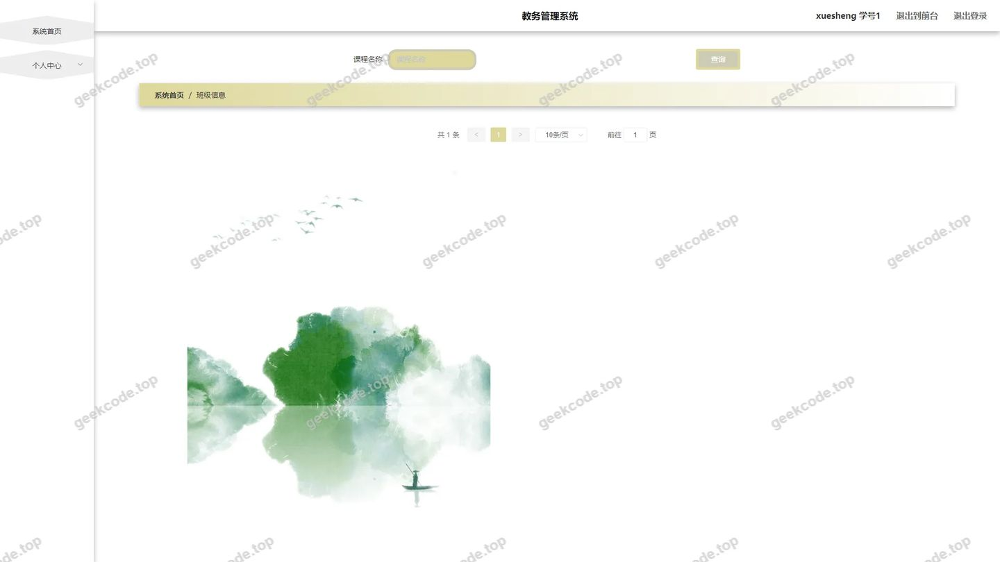
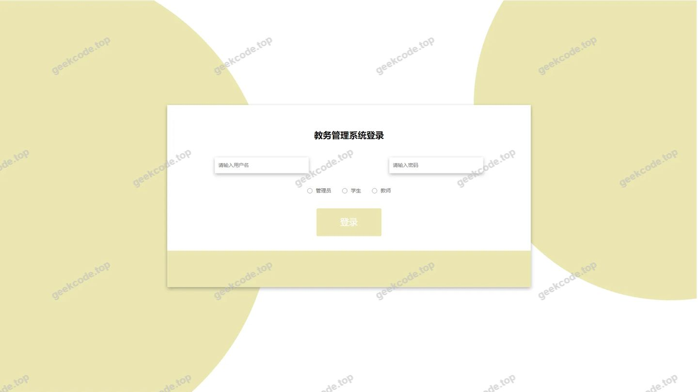
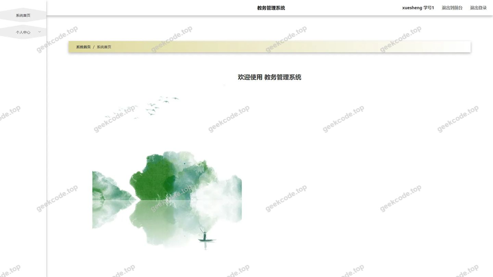
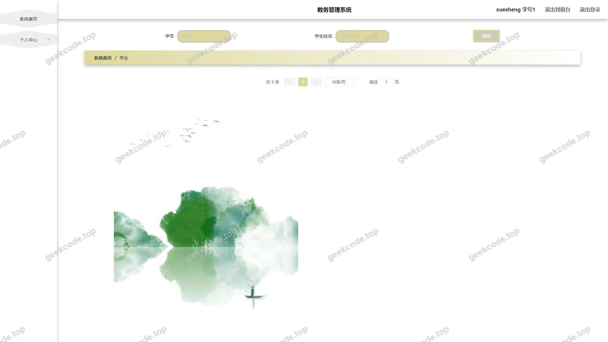
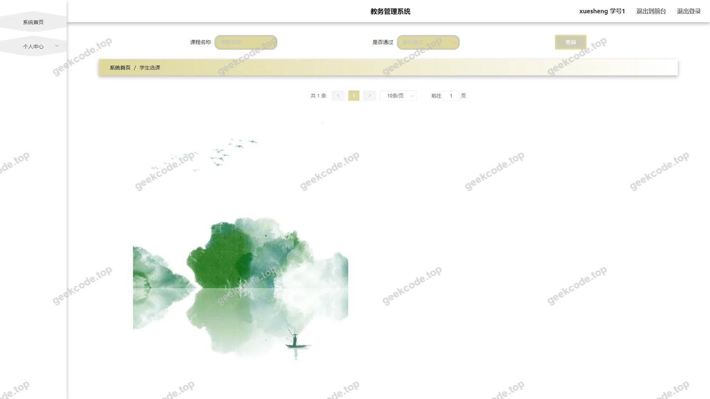

# 教务管理系统

> 🎓 **计算机毕业设计 · 教务管理系统**
>
> 本仓库只放**项目介绍 + 运行截图**（截图是站点带水印的原图，存在仓库 `images/` 里）。
>
> 👉 **完整可运行源码 / 数据库脚本 / 部署文档：[点我获取](https://geekcode.top/archives/%E6%95%99%E5%8A%A1%E7%AE%A1%E7%90%86%E7%B3%BB%E7%BB%9F?utm_source=github)**
>
> 💬 咨询微信：**ir9372**　|　🌐 更多项目：[极客代码 geekcode.top](https://geekcode.top/?utm_source=github)
>
> 📌 项目详情页：<https://geekcode.top/archives/%E6%95%99%E5%8A%A1%E7%AE%A1%E7%90%86%E7%B3%BB%E7%BB%9F?utm_source=github>

<table><td width="230" align="center"> <b>扫码加微信 ir9372</b></td><td valign="middle">📦 源码 = 项目介绍 + 全部运行截图 + 数据库 + 部署文档 👉 点上方任意截图，直接跳到 <b>极客代码 geekcode.top</b> 详情页</td></table>

---

<h1>教务管理系统</h1>
<h2>项目概述</h2>

本教务管理系统旨在为高校提供一体化的教学管理解决方案，涵盖课程发布、学生选课、成绩管理及缴费统计等核心业务流程。系统采用前后端分离架构，前端基于 Vue 框架实现响应式界面，后端使用 Spring Boot 构建 RESTful API。主要功能包括前台展示课程信息、公告通知及个人中心数据查询，后台支持管理员对班级、教师、学生、课程类型及综合信息进行全生命周期管理。该系统适用于高校教务处及院系管理人员，通过 Shiro 安全框架保障数据访问权限，利用 MyBatis-Plus 提升数据库操作效率，有效解决了传统教务管理中信息分散、流程繁琐的问题，提升了教学管理的数字化水平与用户体验。

<h2>技术架构</h2>
<h3>整体架构设计</h3>

本项目采用经典的前后端分离架构模式。前端负责视图渲染与用户交互，通过 HTTP 请求与后端进行数据通信；后端专注于业务逻辑处理、数据持久化及安全控制。这种架构降低了模块间的耦合度，便于独立部署与维护。

<h3>核心技术选型</h3>
<ol>
<li><strong>后端框架</strong>：选用 <code>spring-boot-starter-web</code> 作为基础 Web 容器，简化配置并快速启动服务。集成 <code>mybatis-spring-boot-starter</code> 和 <code>mybatis-plus</code> 作为 ORM 框架，利用其强大的 CRUD 生成能力和条件构造器，大幅减少样板代码，提高开发效率。</li>
<li><strong>安全机制</strong>：引入 <code>shiro-spring</code> 实现身份认证与权限控制，确保不同角色（如管理员与普通用户）只能访问授权范围内的资源，保障系统数据安全。</li>
<li><strong>数据持久层</strong>：使用 <code>mysql-connector-java</code> 连接 MySQL 数据库，配合 <code>spring-boot-starter-jdbc</code> 管理事务与连接池。</li>
<li><strong>工具类库</strong>：依赖 <code>commons-lang3</code> 提供通用字符串与对象处理工具，<code>validation-api</code> 用于接口参数校验，<code>protobuf-java</code> 可能用于特定高效数据传输或序列化场景。</li>
</ol>
<h3>数据库设计要点</h3>

数据库围绕教务核心实体建模，主要包括学生、教师、班级、课程、选课记录、成绩、缴费信息及公告等表结构。各表之间通过外键关联（如学生ID关联选课表），保证数据一致性。针对高频查询字段（如学号、课程名称）建立索引以优化性能。

<h2>功能模块</h2>
<h3>前台用户端功能</h3>

前台面向普通师生及访客，侧重于信息浏览与个人数据查看。

<ol>
<li><strong>首页展示</strong>：呈现系统概览及最新动态入口。</li>
<li><strong>课程信息浏览</strong>：展示全校开设的课程列表，包含课程详情及所属类型。</li>
<li><strong>公告信息查看</strong>：实时显示教务处发布的最新通知与政策调整。</li>
<li><strong>个人中心</strong>：<ul>
<li><strong>我的选课</strong>：查看已选课程列表及状态。</li>
<li><strong>我的成绩</strong>：查询历史各科考试成绩。</li>
<li><strong>我的缴费</strong>：查看学费缴纳记录及欠费情况。</li>
<li><strong>个人信息</strong>：查看及维护基本档案信息。</li>
</ul>
</li>
<li><strong>基础信息查询</strong>：<ul>
<li><strong>班级信息</strong>：浏览各行政班级的基本信息。</li>
<li><strong>教师列表</strong>：查看在职教师的简介与联系方式。</li>
<li><strong>课程类型</strong>：了解学校课程的分类体系（如必修、选修）。</li>
<li><strong>综合信息</strong>：聚合展示多维度的教务统计数据或汇总信息。</li>
</ul>
</li>
</ol>
<h3>后台管理端功能</h3>

后台面向系统管理员，提供全面的数据管理与配置能力。

<ol>
<li><strong>登录与安全</strong>：管理员专属登录入口，基于 Shiro 进行身份验证。</li>
<li><strong>基础数据管理</strong>：<ul>
<li><strong>学生管理</strong>：新增、编辑、删除及查询学生档案。</li>
<li><strong>教师管理</strong>：维护教师基本信息及授课资格。</li>
<li><strong>班级管理</strong>：配置班级名称、年级、辅导员等属性。</li>
<li><strong>课程类型管理</strong>：定义和维护课程分类字典。</li>
</ul>
</li>
<li><strong>教务业务管理</strong>：<ul>
<li><strong>课程信息管理</strong>：发布新课程，编辑课程大纲、学分及上课时间。</li>
<li><strong>学生选课管理</strong>：审核选课申请，处理退改修业务，监控选课热度。</li>
<li><strong>成绩管理</strong>：录入、修改及导出学生考试成绩，支持批量操作。</li>
<li><strong>缴费管理</strong>：记录学生缴费流水，核对账单，生成财务报表。</li>
</ul>
</li>
<li><strong>内容发布</strong>：<ul>
<li><strong>公告信息管理</strong>：发布、置顶或删除校园通知公告。</li>
<li><strong>综合信息管理</strong>：维护首页展示的综合性数据板块。</li>
</ul>
</li>
<li><strong>系统配置</strong>：<ul>
<li><strong>系统参数配置</strong>：设置全局变量、开关项及基础运行参数。</li>
<li><strong>文件管理</strong>：上传及管理课件、附件等非结构化数据。</li>
</ul>
</li>
</ol>
<h2>用户角色与权限</h2>

根据系统设计与路由规划，主要划分为两类核心角色，权限隔离清晰。

<h3>1. 管理员 (Admin)</h3>

拥有最高权限，可访问所有后台路由及功能模块。

<ul>
<li><strong>可访问模块</strong>：</li>
<li><code>/zonghexinxi</code> (综合信息管理)</li>
<li><code>/news</code> (公告信息管理)</li>
<li><code>/xueshengxuanke</code> (学生选课管理)</li>
<li><code>/xuesheng</code> (学生信息管理)</li>
<li><code>/xueshengjiaofei</code> (学生缴费管理)</li>
<li><code>/banjixinxi</code> (班级信息管理)</li>
<li><code>/jiaoshi</code> (教师信息管理)</li>
<li><code>/xueshengchengji</code> (学生成绩管理)</li>
<li><code>/kechengxinxi</code> (课程信息管理)</li>
<li><code>/config</code> (系统配置)</li>
<li><code>/kechengleixing</code> (课程类型管理)</li>
<li><code>/</code> (后台首页仪表盘)</li>
<li><strong>权限特征</strong>：具备数据的增删改查（CRUD）完整权限，负责系统运维与数据治理。</li>
</ul>
<h3>2. 普通用户 (User/Student/Teacher)</h3>

仅能访问前台公开页面及个人中心相关数据，无后台管理权限。

<ul>
<li><strong>可访问模块</strong>：</li>
<li><strong>公共信息</strong>：首页、课程信息列表、公告列表、班级信息列表、教师列表、课程类型列表。</li>
<li><strong>个人数据</strong>：个人中心内的选课记录、成绩记录、缴费记录。</li>
<li><strong>权限特征</strong>：只读权限为主，仅允许在个人中心更新部分非敏感个人信息（如联系电话），严禁访问任何 <code>/admin</code> 路由或执行数据修改操作。</li>
</ul>
<h2>项目特色与创新点</h2>
<ol>
<li><strong>全流程闭环管理</strong>：系统覆盖了从“课程发布”到“学生选课”，再到“成绩录入”与“费用结算”的完整教务生命周期，数据在各模块间自动流转，减少了人工重复录入错误。</li>
<li><strong>细粒度权限控制</strong>：基于 Apache Shiro 实现了严格的角色访问控制（RBAC），确保敏感数据（如成绩、缴费）仅在授权范围内可见，符合高校数据隐私保护要求。</li>
<li><strong>高效的数据交互体验</strong>：前端采用 Vue 框架实现组件化开发，结合后端 MyBatis-Plus 的动态 SQL 能力，提供了流畅的信息检索与分页加载体验，特别是在大数据量的选课和成绩查询场景下表现优异。</li>
<li><strong>灵活的配置扩展性</strong>：内置系统配置模块（<code>/config</code>），允许管理员在不重启服务的情况下动态调整部分业务参数，提升了系统的运维灵活性。</li>
</ol>
<h2>部署环境</h2>

为确保教务管理系统稳定运行，需准备以下软硬件环境：

<h3>硬件建议</h3>
<ul>
<li><strong>CPU</strong>：Intel Core i5 及以上或同等性能处理器。</li>
<li><strong>内存</strong>：8GB RAM 及以上（推荐 16GB 以应对并发访问）。</li>
<li><strong>硬盘</strong>：至少 50GB 可用空间（SSD 优先，用于存储数据库日志及上传文件）。</li>
</ul>
<h3>软件环境</h3>
<ol>
<li><strong>Java 运行环境</strong>：<ul>
<li>JDK 1.8 或更高版本（推荐 JDK 8 LTS 或 JDK 11）。</li>
</ul>
</li>
<li><strong>数据库服务</strong>：<ul>
<li>MySQL 5.7 或 MySQL 8.0 及以上版本。</li>
<li>需启用 InnoDB 存储引擎以支持事务和外键约束。</li>
</ul>
</li>
<li><strong>Web 服务器</strong>：<ul>
<li>内置 Tomcat（由 Spring Boot Starter Web 提供，无需单独安装外部 Tomcat，但生产环境建议搭配 Nginx 做反向代理）。</li>
</ul>
</li>
<li><strong>前端运行环境</strong>：<ul>
<li>Node.js 14.x 或 16.x 版本（用于编译 Vue 前端项目）。</li>
<li>npm 或 yarn 包管理器。</li>
</ul>
</li>
<li><strong>操作系统</strong>：<ul>
<li>Windows Server 2016/2019, Linux (CentOS 7+, Ubuntu 20.04+) 或 macOS。</li>
</ul>
</li>
</ol>
<h2>五、技术特性</h2>
<ul>
<li>前后端集成部署，前端资源打包至后端 static 目录</li>
<li>使用 MyBatis-Plus 简化数据访问层开发</li>
<li>集成 Shiro 权限框架实现角色权限控制</li>
</ul>
<h2>六、功能模块截图</h2>
<h3>前台用户端</h3>
<h4>前台-班级信息列表</h4>

<h4>前台-教师列表</h4>

<h4>前台-课程类型列表</h4>

<h4>前台-课程信息列表</h4>

<h4>前台-学生成绩列表</h4>

<h4>前台-学生缴费列表</h4>

<h4>前台-学生选课列表</h4>

<h4>前台-综合信息列表</h4>

<h4>前台-个人中心</h4>

<h4>前台-公告列表</h4>

<h3>后台管理端</h3>
<h4>后台-班级信息</h4>

<h4>后台-登录页</h4>

<h4>后台-公告信息</h4>

<h4>后台首页</h4>

<h4>后台-学生</h4>

<h4>后台-学生缴费</h4>

<h4>后台-学生选课</h4>

<h4>后台-综合信息</h4>

---

## 获取完整源码

| 项目 | 说明 |
| --- | --- |
| 项目名 | 教务管理系统 |
| 运行截图 | 本文 19 张（站点带水印原图，仓库 `images/` 目录） |
| 完整源码 | [https://geekcode.top/archives/%E6%95%99%E5%8A%A1%E7%AE%A1%E7%90%86%E7%B3%BB%E7%BB%9F?utm_source=github](https://geekcode.top/archives/%E6%95%99%E5%8A%A1%E7%AE%A1%E7%90%86%E7%B3%BB%E7%BB%9F?utm_source=github) |
| 咨询微信 | **ir9372**（备注：jingpin-yuanma） |
| 更多项目 | [极客代码 geekcode.top](https://geekcode.top/?utm_source=github) |

> 需要源码、部署、改配置、跑不起来等问题，加微信 ir9372 沟通，说明项目名即可。
